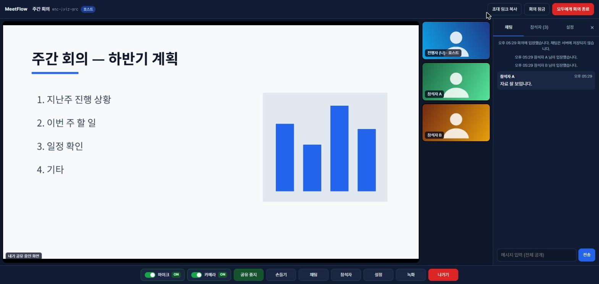
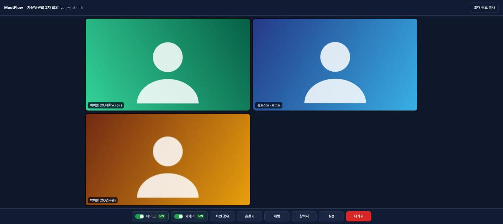

# MeetFlow _(meetflow-oss)_


LiveKit SFU 기반 소규모(20인 이하) 자체 호스팅 화상회의 — 초대 링크 + 회의 비밀번호, 대기실, 호스트 제어



외부 참석자를 계정 없이 **초대 링크 + 회의 비밀번호**로 부르는 화상회의입니다. 회의는 내부 담당자만 만들 수 있고, 영상·음성·채팅은 자체 서버를 벗어나지 않습니다. 서버에 회의 내용을 저장하지 않습니다.
Docker Compose 하나로 노트북에서 시험하고, 공인 IP 하나뿐인 서버(도메인 없음)에도 HTTPS로 올릴 수 있습니다.

만든 과정과 시험 방법은 [해설 글](https://jason-log.notion.site/AI-PoC-400b37d1f4498168b1cfca0913f40dae)에 정리했습니다.

> **상태: PoC.** 실제 회의(10인 이상 동시 접속)로 검증했지만, 대규모·장기 운영용으로 다듬은 제품은 아닙니다. [한계](#한계)를 먼저 읽어 주십시오.

## 목차

- [기능](#기능)
- [빠른 시작](#빠른-시작)
- [구성](#구성)
- [환경 변수](#환경-변수)
- [배포](#배포)
- [보안 설계](#보안-설계)
- [한계](#한계)
- [개발·시험](#개발시험)
- [기여](#기여)
- [라이선스](#라이선스)

## 기능

| 대상 | 기능 |
|---|---|
| 참석자 | 링크 + 비밀번호로 입장(가입 없음), 입장 전 장치 점검(카메라·마이크·스피커 시험음), 마이크·카메라 ON/OFF, 화면 공유(음성 포함), 채팅, 손들기, 크게 보기 |
| 호스트 | 회의 생성(호스트 코드 필요), 대기실 입장 승인·거절, 회의 잠금, 비밀번호 변경, 참석자 음소거·화면 공유 중지·내보내기, 모두에게 회의 종료 |
| 녹화 | 호스트 PC에만 저장(탭 화면 + 전원 음성, webm). 녹화 중에는 전원 화면에 「● 녹화 중」 표시 |
| 화면 | 창 크기에 맞춰 타일 자동 배치(스크롤 없음), 누가 화면을 공유하면 그 화면을 크게 표시, 휴대폰 화면 지원 |
| 개인정보 | 서버 녹화·채팅 저장 없음, 회의 정보는 만료 시간(기본 24시간) 뒤 자동 삭제 |



## 빠른 시작

Docker(Docker Desktop 또는 Docker Engine + Compose v2)와 최신 크롬·엣지가 필요합니다. macOS·Linux에서는 `openssl`도 필요합니다.

1. 저장소를 받습니다.
2. 실행 스크립트를 돌립니다. 처음 실행하면 `.env`가 만들어지고 키·시크릿·호스트 코드가 난수로 채워지며, 호스트 코드가 화면에 출력됩니다.
3. 브라우저에서 `http://localhost:3000`을 열고 호스트 코드로 회의를 만듭니다.
4. 표시된 초대 링크를 다른 탭에서 열고 회의 비밀번호로 입장을 요청한 뒤, 호스트 탭에서 승인합니다(대기실은 기본으로 켜져 있습니다).

```bash
git clone https://github.com/jason-log/meetflow-oss.git && cd meetflow-oss && ./start.sh
```

Windows에서는 `start.bat`을 실행합니다. 상태 확인은 `docker compose ps`, `curl http://localhost:3000/api/health`입니다.

## 구성

```
브라우저 ──HTTPS/WSS──▶ Caddy ──▶ backend (회의·비밀번호·토큰·호스트 제어, 웹앱 제공)
   │                      └──/rtc──▶ LiveKit (시그널링)
   └──────── UDP 7882 / TCP 7881 (미디어) ────────▶ LiveKit SFU
                                       backend ──▶ Valkey (회의 정보, TTL)
```

그림은 IP 서버 배포 기준입니다. 도메인 배포는 LiveKit을 별도 도메인(`LIVEKIT_DOMAIN`)으로 받고, 로컬 실행은 Caddy 없이 브라우저가 3000·7880에 바로 접속합니다.

- **SFU**(Selective Forwarding Unit): 각 참석자가 영상을 서버에 한 번만 올리고 서버가 나머지에게 나눠 주는 방식입니다. 참석자 수가 늘어도 각자의 업로드 대역폭이 거의 늘지 않습니다.
- **TURN**: UDP나 비표준 포트가 막힌 망의 참석자를 위해 미디어를 서버가 대신 중계하는 방식입니다. 선택 기능입니다([배포](#turntls-443-확장-선택)).
- **ICE**: 브라우저와 서버가 쓸 수 있는 연결 경로(UDP·TCP·중계)를 시험해 되는 것을 고르는 절차입니다.

| 서비스 | 역할 | 외부 공개 포트 |
|---|---|---|
| livekit (v1.13.8) | WebRTC SFU 미디어 서버 | 7881/tcp(ICE/TCP), 7882/udp(미디어) |
| redis (Valkey 8.1) | 회의 정보(TTL) 저장 | 없음 |
| backend (Node 22, Express) | 회의 생성·비밀번호 검증·토큰 발급·호스트 제어, 웹앱 제공 | 없음(127.0.0.1:3000) |
| caddy (prod 프로필) | HTTPS/WSS 인증서 자동 발급·프록시 | 80/tcp, 443/tcp, 443/udp |

프런트는 빌드 단계가 없는 정적 파일 3개(`backend/public/`)입니다. 외부 CDN 없이 스크립트·스타일은 자기 서버(`'self'`)에서만 받고, 접속 허용 대상은 자기 서버와 LiveKit 주소뿐입니다(CSP).

## 환경 변수

`.env.example`을 `.env`로 복사해 씁니다(실행 스크립트가 자동으로 합니다). `.env`는 git·메일·메신저로 공유하지 않습니다.

| 변수 | 기본값 | 설명 |
|---|---|---|
| `MEETFLOW_ENV` | `development` | 운영은 `production` — 약한 키 거부·wss 강제·HSTS 등 운영 안전 점검이 켜집니다 |
| `LIVEKIT_API_KEY` / `LIVEKIT_API_SECRET` | 자동 생성 | LiveKit 키(8자 이상)·시크릿(32자 이상) |
| `HOST_ACCESS_CODE` | 자동 생성 | 회의를 만들 수 있는 내부 담당자용 코드(8자 이상). 외부 참석자에게 주지 않습니다 |
| `LIVEKIT_PUBLIC_URL` | `ws://localhost:7880` | 브라우저가 접속할 LiveKit 주소. 운영은 `wss://…` |
| `LIVEKIT_NODE_IP` | `127.0.0.1` | LiveKit이 참석자에게 알려 줄 미디어 IP. 운영은 서버 공인 IP |
| `TRUST_PROXY` | `0` | 리버스 프록시(Caddy) 뒤에서는 `1` — 실제 접속자 IP로 속도 제한을 겁니다 |
| `MAX_PARTICIPANTS` | `20` | 회의당 정원(2~50) |
| `ROOM_TTL_HOURS` | `24` | 회의 정보 보관 시간(1~336) |
| `APP_DOMAIN` / `LIVEKIT_DOMAIN` | `meet.example.com` / `livekit.example.com` | 도메인 배포 시 웹·LiveKit 도메인(필수) |
| `TURN_DOMAIN` / `TURN_CERT_DIR` | `turn.example.com` / Let's Encrypt 경로 | TURN/TLS 확장을 쓸 때만 |

위 표는 로컬·도메인 배포(`docker-compose.yml`) 기준입니다. IP 서버 배포(`docker-compose.server.yml`)는 `scripts/init-server-env.sh`가 `PUBLIC_IP`·`TLS_MODE`·키를 담은 `.env`를 따로 만들고, 운영 모드·wss·`TRUST_PROXY=1`은 Compose 파일에 고정돼 있습니다.

## 배포

### 공인 IP만 있는 서버 (도메인 없음)

웹·API·LiveKit 시그널링이 443 하나를 경로(`/rtc`)로 나눠 씁니다. 설정은 `docker-compose.server.yml` + `Caddyfile.server`로 끝납니다. 아래 `203.0.113.10`은 문서용 예시 IP이므로 실제 공인 IP로 바꿉니다.

```bash
# 최초 1회
cd ~ && git clone https://github.com/jason-log/meetflow-oss.git && cd meetflow-oss && bash scripts/init-server-env.sh 203.0.113.10 internal
# 배포·갱신
cd ~/meetflow-oss && git pull origin main && docker compose -f docker-compose.server.yml up -d --build && docker compose -f docker-compose.server.yml ps
```

- `TLS_MODE=internal`: Caddy 자체 인증서입니다. 접속할 때 경고가 한 번 뜨며, 내부망 시험용입니다.
- `TLS_MODE=public`: Let's Encrypt IP 인증서(6일 수명, 자동 갱신)입니다. 443/tcp가 인터넷에 열려 있어야 발급·갱신됩니다. 바꾼 뒤 `docker compose -f docker-compose.server.yml up -d caddy`를 실행합니다.
- 공개 포트는 443/tcp, 7881/tcp, 7882/udp, 3478/udp이며 모두 `PUBLIC_IP`에만 묶입니다. 80/tcp는 쓰지 않아 같은 서버의 다른 웹 서비스와 겹치지 않습니다.
- Docker가 연 포트는 호스트 방화벽(UFW 등)을 거치지 않을 수 있습니다. 노출 통제는 경계 방화벽이나 `DOCKER-USER` 체인으로 합니다.
- IP만으로는 TURN/TLS 443을 쓸 수 없습니다. 웹(443)만 허용하는 망의 참석자가 있다면 도메인을 마련해 아래 방식으로 바꿉니다.

### 도메인이 있는 서버

`.env`에서 `MEETFLOW_ENV=production`, `TRUST_PROXY=1`, `LIVEKIT_PUBLIC_URL=wss://livekit.<도메인>`, `LIVEKIT_NODE_IP=<공인 IP>`, `APP_DOMAIN`, `LIVEKIT_DOMAIN`을 채운 뒤 실행합니다.

```bash
docker compose --profile prod up -d --build
```

> [!WARNING]
> `MEETFLOW_ENV=production`이 빠지면 운영 안전 점검이 꺼집니다. 이때 `TRUST_PROXY=1`도 빠지면 모든 접속이 프록시 IP 하나로 보여 속도 제한이 회의 전체를 막으며, 백엔드는 이를 감지하면 로그에 경고를 한 번 남깁니다. `MEETFLOW_ENV=production`에서 `TRUST_PROXY=0`이면 백엔드가 시작하지 않습니다.

### TURN/TLS 443 확장 (선택)

UDP와 7881/tcp가 막힌 망의 참석자를 위해 미디어를 443/tcp TLS로 중계합니다. 공인 443은 `edge`(nginx stream)가 받아 SNI로 `turn.<도메인>`은 LiveKit 내장 TURN으로, 나머지는 Caddy로 나눕니다(PROXY protocol로 실제 IP 전달). `.env`에 `TURN_DOMAIN`을 넣고 DNS를 추가한 뒤 실행합니다. Docker Compose v2.24.4 이상이 필요합니다.

```bash
docker compose -f docker-compose.yml -f docker-compose.turn.yml --profile prod up -d --build
```

- 첫 기동 때 Caddy가 TURN 인증서를 받기 전까지 livekit이 재시작을 반복합니다(정상, 1~2분).
- 인증서 갱신(약 60일 주기) 뒤에는 `docker compose restart livekit`이 필요합니다.
- 접속 경로 점검: 회의 주소 뒤에 `?relay=1`(중계 강제) 또는 `?diag=1`을 붙이고 브라우저 콘솔에서 `await meetflowDiag()`를 실행합니다.

## 보안 설계

- **권한 3단계**: 회의 생성은 호스트 코드, 입장은 회의 비밀번호, 호스트 제어는 회의마다 새로 발급하는 호스트 키(32바이트 난수)로 나뉩니다. 서버는 비밀번호를 scrypt 해시로, 호스트 키는 SHA-256 해시로만 저장합니다.
- **대입 방지**: 비밀번호 실패 10회/10분, 호스트 코드 실패 10회/15분 제한이 있습니다. IPv6는 /64 단위로 묶어 셉니다. 회의 코드는 약 9.5×10¹³가지입니다.
- **토큰**: LiveKit 참가 토큰은 2분 수명이고 관리 권한(roomAdmin)이 없습니다. 참석자 역할은 서버가 서명해 넣으므로 참석자가 호스트를 흉내 낼 수 없습니다.
- **웹**: 외부 스크립트·인라인 스크립트가 없습니다(CSP `script-src 'self'`, `frame-ancestors 'none'`, `no-referrer`). 화면 출력은 모두 `textContent`입니다. 이름의 제어문자·양방향 조작 문자는 서버에서 지웁니다.
- **운영 점검**: 운영 모드에서는 공개된 기본값·시험값 키, `ws://` 주소, `TRUST_PROXY=0`이면 백엔드가 시작하지 않습니다.

취약점은 공개 Issue에 쓰지 말고 [SECURITY.md](SECURITY.md)의 방법으로 알려 주십시오.

## 한계

- **내보낸 참석자의 재접속**: 접속 중에는 LiveKit 서버가 갱신 토큰을 내려줍니다. 그래서 개조한 클라이언트로 그 토큰을 써 다시 들어오는 것까지는 막지 못합니다. 확실히 막으려면 내보낸 뒤 회의를 잠그거나 비밀번호를 바꿉니다.
- **호스트 제어는 강제가 아닙니다**: 음소거·화면 공유 중지 뒤 참석자가 다시 켤 수 있고, 모든 참석자가 화면을 공유할 수 있습니다.
- **녹화 표시**: 「● 녹화 중」은 호스트 브라우저가 5초마다 알리는 방식이며 서버가 보증하지 않습니다. 녹화 동의 문구와 보관 기간은 운영 기관이 정합니다.
- **단일 인스턴스 전제**: 속도 제한 기록은 백엔드 메모리에 있어 재시작하면 초기화되고, 백엔드를 여러 대로 늘리면 공유되지 않습니다.
- **브라우저**: 최신 크롬·엣지 기준으로 시험했습니다. 자체 인증서(`TLS_MODE=internal`)에서는 휴대폰 접속이 실패할 수 있어, 외부 참석자를 부를 때는 정식 인증서(`TLS_MODE=public` 또는 도메인)를 씁니다.

## 개발·시험

```bash
cd backend && npm install && npm test
```

Redis는 ioredis-mock, LiveKit은 스텁으로 대체한 API 단위 시험 24건입니다(Node 22, Docker·LiveKit 불필요).

## 기여

질문·버그 제보는 [Issues](https://github.com/jason-log/meetflow-oss/issues)에 남겨 주십시오. 개인이 운영하는 PoC라 답이 늦을 수 있습니다. 코드 변경(PR)은 먼저 Issue로 방향을 맞춘 뒤 보내 주시면 검토합니다.

## 라이선스

[Apache-2.0](LICENSE) © 2026 The MeetFlow Authors

사용한 구성요소: LiveKit Server·livekit-client(Apache-2.0), Valkey(BSD-3-Clause), Caddy(Apache-2.0), nginx(BSD-2-Clause).
